# Classroom Air Quality and Comfort: Forecasting CO2 and Temperature, Ventilation Alerts and Room Capacity

This project uses real sensor data from **23 teaching rooms (33 sensors) at a German university of applied sciences** to do three things:
- forecast CO2 and temperature up to an hour ahead;
- warn before a room's air becomes unhealthy;
- estimate how many people each room can hold.

Nine models, from simple baselines to deep neural networks, were compared under an evaluation designed to prevent **data leakage**. A gradient-boosted tree model was chosen because it was the most consistently accurate and by far the fastest to train. The results are useful but modest. The models help most while a class is in progress, and they are fundamentally limited by the absence of timetable data. This README reports what the evidence supports and no more.

## Contents
1. [Overview](#1-overview)
2. [My Role and How the Project Evolved](#2-my-role-and-how-the-project-evolved)
3. [Key Findings](#3-key-findings)
4. [Data](#4-data)
5. [What the Data Shows](#5-what-the-data-shows)
6. [Method](#6-method)
7. [The Methods, Explained in My Own Words](#7-the-methods-explained-in-my-own-words)
8. [Results](#8-results)
9. [Room Recommendations](#9-room-recommendations)
10. [Limitations and Future Work](#10-limitations-and-future-work)
11. [Design Decisions and Robustness](#11-design-decisions-and-robustness)
12. [Guide Values Used](#12-guide-values-used)
13. [How to Run](#13-how-to-run)
14. [License](#14-license)
15. [Contact](#15-contact)

---

## 1. Overview

Poor classroom air is common and easy to miss. CO2 from breathing builds up within minutes in a full room, and high levels are linked to tiredness and poorer concentration. German guidance (Umweltbundesamt) treats **1000 ppm** as the limit for good air and **2000 ppm** as unacceptable. The German workplace rule ASR A3.5 sets **20–26 °C** for seated work.

The project turns minute-by-minute sensor readings into decisions:

| Who | What they get |
|---|---|
| **Building managers** | Which rooms have bad air, which overheat or stay cold, and where ventilation, shading, cooling or heating is needed |
| **Room planners** | An estimate of how many students each room can hold before the air gets bad |
| **Lecturers or a building dashboard** | A warning about 30 minutes before a room passes 1000 ppm ("air this room soon"), instead of a fixed timer |

**At a glance:**
- **Forecasting:** CO2 30 minutes ahead is about 17% more accurate than assuming "no change" while people are in the room. Temperature is about 33% more accurate, though the absolute gain is tiny (section 8.2).
- **Alert:** warns before a room passes 1000 ppm, with F1 0.87 overall and 0.59 on true early warnings.
- **Generalisation:** the models still work on rooms they never saw and on the following year.
- **Rooms:** ground-floor rooms regularly exceed 2000 ppm, and upper-floor rooms are above 26 °C for about a quarter of teaching time.
- **Capacity:** with windows shut, a typical seminar room keeps CO2 below 1000 ppm for only about 8–13 people.

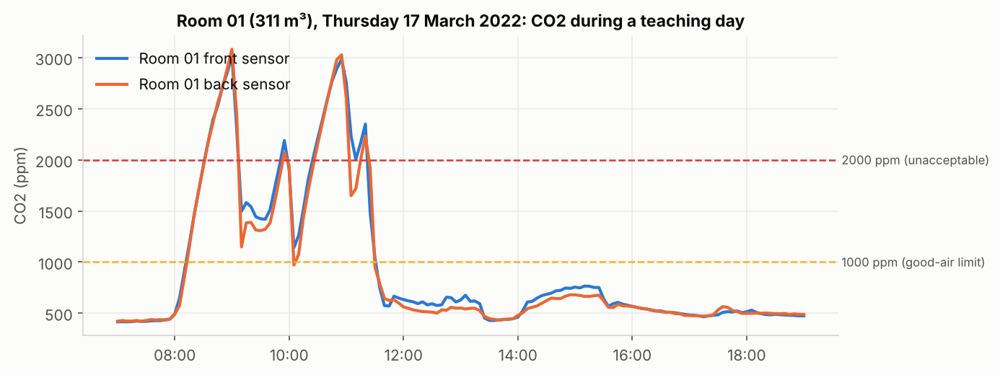
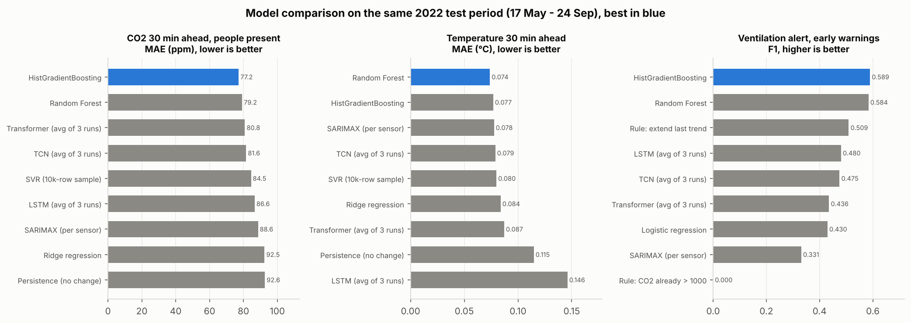

---

## 2. My Role and How the Project Evolved

**Data source.** Real sensor data from 33 sensors in 23 teaching rooms of a German university of applied sciences, January–September 2022 and May–October 2023. The data comes from the university's LoRaWAN network of battery-powered Elsys ERS CO2 sensors, which record CO2, temperature, humidity, light and motion.

**Data ethics.** The data is not public, so the institution is not named and the raw and processed data files are not included in this repository. The code, results and figures are shared in full. The data can be shared privately on request, subject to the data owner's agreement.

**2023: the first version.** I first analysed this data in 2023 as a freelance data-science project for a client in Germany, working remotely. That version used linear regression to estimate the **current** temperature from other readings taken at the **same moment**, and scored it on a random 80/20 split. It reported R² = 0.60 and 0.74, which I described at the time as a near-perfect fit.

**2026: what I rebuilt, and why.** Returning to the project, I found that those scores were largely **spurious**. The task had no practical use, and the random split let the model be tested on near-copies of its training rows. I rebuilt the project around a question with practical value, *what will happen next, and what should be done?*, and around an evaluation that cannot flatter the models. All processing, modelling, evaluation and recommendations are my own work.

| | 2023 version | 2026 version |
|---|---|---|
| Question | Estimate temperature *now* from other readings *now* | Forecast CO2 and temperature 15–60 min ahead; warn before 1000 ppm; estimate room capacity |
| Data used | First 80,000 rows per file (a few winter weeks) | All data: about 11 million readings per measurement for 2022, plus 2023 |
| Testing | Random 80/20 split | Train on earlier months, test on later months; unseen rooms; the following year |
| Baseline | None | Every model compared with "no change" (persistence) |
| Models | Linear regression | Nine models, each tuned on separate validation weeks |
| Reported result | R² 0.60–0.74, described as a near-perfect fit | Modest, measured gains, with limitations stated |

**This is my first research-style project.** I have tried to apply careful methods and to report the results with appropriate caution. Where a result is weak or uncertain, I have said so.

### What was wrong with the first version

| Problem | Why it matters | Fix |
|---|---|---|
| **Wrong task.** It estimated the temperature *right now* from other readings taken *right now*. | The sensor already measures temperature, so this has no practical use. It doesn't tell anyone what's about to happen. | Predict the **future** (15/30/60 min ahead) and raise an **alert** before 1000 ppm. |
| **Random split on minute-by-minute data.** | Neighbouring minutes are almost identical, so the model is tested on near-copies of its training rows. Scores look far better than they are. | Train on the past (18 Jan–15 May 2022) and test on the future (17 May–24 Sep 2022). Also test on **rooms the model never saw** and on the **next year (2023)**. |
| **No baseline.** | An R² means little on its own: "the value 30 minutes from now equals the value now" already scores R² ≈ 0.72 for CO2. | Every model is compared with that **persistence** baseline. |
| **Partial data, and misreadings.** Only the first 80,000 rows per file were read; IDs were used as numeric features; MSE ≈ 1 was described as a perfect fit. | Limited the data to a few weeks of winter. MSE depends on the units, so "close to 1" doesn't mean good. | All data is used, IDs are no longer features, and results are reported as MAE in ppm or °C plus skill against the baseline. |

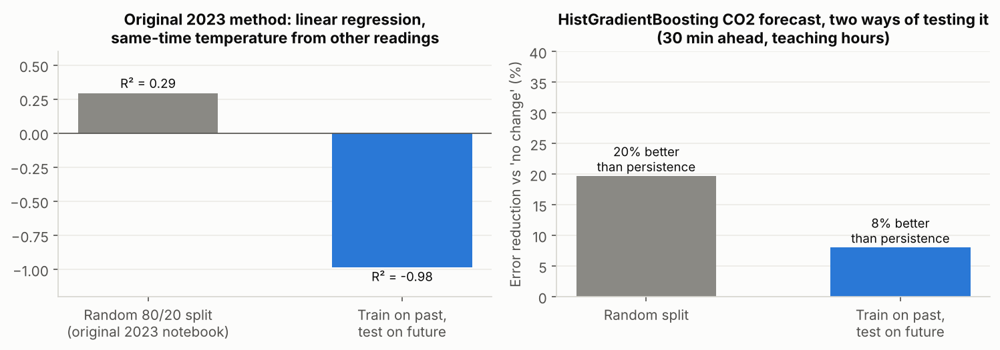

*Left:* the original 2023 method (linear regression), on the full 2022 data, gives R² = 0.29 on a random split and **R² = −0.98** when tested on later months. That's worse than predicting the average every time. *Right:* the HistGradientBoosting CO2 forecast looks 2.5× better on a random split (20% better than the baseline) than on an honest time split (8%). That gap is the leakage.


*Left:* the original 2023 method, re-run on the full 2022 data, gives R² = 0.29 on a random split and **R² = −0.98** when tested on later months. That's worse than predicting the average every time. *Right:* the chosen CO2 forecast looks 2.5× better on a random split (20% better than the baseline) than on an honest time split (8%). That gap is the leakage.

**Regression or classification? Both, for different questions.**
- **Regression** answers "what will CO2 and temperature be in 30 minutes?".
- **Classification** answers the decision question "do we need to air this room in the next 30 minutes?".
- **Capacity** ("how many students?") can't be learned from this data, because there are no head counts. It comes from a standard CO2 mass-balance model calibrated with the measured data (section 9).

---


---

## 3. Key Findings


1. **Ground-floor rooms (Rooms 01–03) have the worst air.** They regularly pass 2000 ppm, which the German environment agency (UBA) calls unacceptable. One room reached 3,000 ppm within an hour of a lecture starting.
2. **Upper-floor rooms overheat:** they're above 26 °C for 25–31% of teaching time. Lecture hall Room 07 and Room 23 are often too cold.
3. **With windows shut, a typical seminar room stays under 1000 ppm for only 8–13 people.** Airing fully every 20 minutes roughly doubles that.
4. **Forecasting works partly:**
   - **CO2:** about 17% more accurate than "no change" while a class is running. The models can't predict *when* the next class starts, because the timetable isn't in the data.
   - **Temperature:** forecasts are 33% more accurate than "no change", but that's only about 0.04 °C, below the sensor's own ±0.2 °C accuracy. The useful temperature output is the room-level picture, not the forecast.
5. **The alert works.** It warns before the limit on about 55% of occasions, and it still works on unseen rooms and on 2023.
6. **On this data, the tree models (HistGradientBoosting, Random Forest) beat the deep networks** (LSTM, TCN, Transformer), SVR and SARIMAX.
7. **The original 2023 approach was misleading.** A random split made its scores look far better than they were (section 2).

---


---

## 4. Data

### 4.1 The Data folder
The data isn't included in this repository. To run the code, place the data files in a `Data/` folder with this layout:

| Item | What it is | Used by the code? |
|---|---|---|
| `sensor_info.txt` | The sensor's specification: LineMetrics LoRa CO2 sensor (Elsys ERS-CO2). It lists the measuring ranges and accuracy: CO2 0–10,000 ppm (±50 ppm up to 2,000 ppm), temperature 0–50 °C (±0.2 °C), humidity 0–85% (±2%), light 4–2,000 lux, motion 0–256 counts. | Its ranges are used to throw away impossible readings |
| `Classroom_List_FK10.xlsx` | The only Excel file. It is the key that links sensors to rooms, with one row per sensor (33 sensors in 23 rooms). Columns: **Room** (the room code; the code replaces these with anonymous names, Room 01 to Room 23); **DataSetID** (24–46, the room number used in the 2022 file names); **Sensor_ID** (hardware ID); **Thing ID** (140–172, the sensor number used in the 2023 files); **Start_Datum** (installation date, 18 Jan 2022); **Room Volume** in m³; **Comments** (where the sensor sits in rooms with several sensors, e.g. front/back, above/below). The stray number in the last row is ignored. | Yes, to name rooms and add room volume |
| `Sensor Data_2022\` | **Raw 2022 data**, 165 CSV files exported from MATLAB (hence `.mat.csv`). File names follow `dat_HS0<DataSetID>_<VARIABLE>_<sensor no.>.mat.csv`, with one file per sensor per variable. Variables: **CO2** (ppm), **TMP** (temperature, °C), **RLF** (*relative Luftfeuchte*, relative humidity, %), **LUX** (light), **PIR** (motion count). Each file has a time column and a value column, one reading per minute. | No; DF22 is built from it |
| `DF22\` | **Processed 2022 data**, one CSV per room (`24.csv` … `46.csv`, named by DataSetID). The first notebook built it by merging the five variable files of each sensor into one table with columns `Time, DataSetID, SensorNumber, CO2, LUX, PIR, RLF, TMP`. Covers 18 Jan–24 Sep 2022 at 1-minute resolution. | **Yes, this is the 2022 input** |
| `Sensor Data 2023\` | **Raw 2023 data**, downloaded from the university's sensor cloud. One CSV per sensor: `Sensor <DataSetID>.csv` is the room's first sensor, and `-1` and `-2` are its second and third sensors (for example `Sensor 24.csv` = Room 01 front, `24-1` = Room 01 back, `30`/`30-1`/`30-2` = the three sensors in lecture hall Room 07). This is the same numbering as `_1`, `_2`, `_3` in the 2022 file names. `Sensor 25-1.csv` (Room 02 back sensor) is empty. It is in long format, one row per reading: `phenomenonTime` (UTC time), `result` (the value), `@iot.id` (data-stream ID), `name` (CO2, Humidity, Light, Motion, Room Temperature, VDD = battery voltage), `thing_id` (sensor, matching Thing ID in the room list). Covers about 25 May–23 Oct 2023, with gaps. | **Yes, this is the 2023 input** (processed by the code) |


**Room names.** The original room codes are replaced with anonymous names. Rooms 01–07 are on the ground floor (Room 07 is a large lecture hall), Rooms 08–14 are on the 1st floor, Rooms 15–17 on the 2nd and Rooms 18–23 on the 3rd.

### 4.2 Coverage

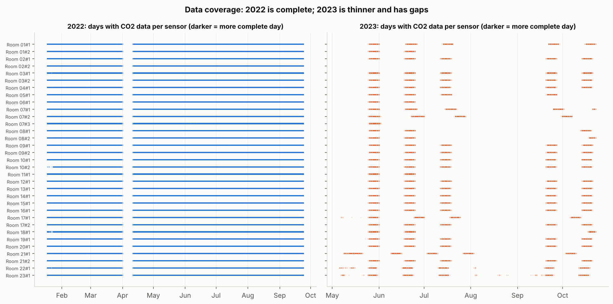

- **2022:** complete from 18 January to 24 September, apart from 2–10 April, when no sensor has data.
- **2023:** patchy. Each sensor has only a few week-long stretches of data between May and October, and most have nothing from August to mid-September.

### 4.3 How the data is processed (`data_prep.py`)

The two years arrive in different layouts. The processing turns both into **one common table**: one row per sensor per 5 minutes, with the same columns for both years:

`time, room, sensor_key, volume_m3, co2, tmp, rlf, lux, pir`

| Step | 2022 | 2023 |
|---|---|---|
| 1. Read | All 23 `DF22` room files (all 33 sensors, every minute). DF22 was spot-checked against the raw `Sensor Data_2022` files: 7 raw files from two rooms (Room 04, all five measurements; Room 01 back sensor, CO2 and motion). Every raw reading was present in DF22 and every value matched exactly. | All 33 `Sensor` files: 32 sensors with data, plus one empty file (Room 02 back sensor). |
| 2. Layout | Already one column per measurement. | Long format (one row per reading) turned into one column per measurement. 0 exact duplicate readings were found. |
| 3. Names | CO2, TMP, RLF, LUX, PIR → `co2, tmp, rlf, lux, pir` | CO2, Room Temperature, Humidity, Light, Motion → the same five names |
| 4. Time | German local time (kept) | UTC converted to German local time, so "09:00" means the same in both years |
| 5. Impossible values | Readings outside the sensor's range are set to missing (not the whole row; see the audit below) | same |
| 6. Common time step | 1-minute readings → 5-minute averages (motion is **summed** over the 5 minutes, because it is a count) | irregular readings → the same 5-minute averages and motion sums |
| 7. Room information | Each sensor is linked to its room and room volume through `Classroom_List_FK10.xlsx` (DataSetID + sensor number) | same, through Thing ID |

**Every sensor stays separate.** Rooms with two or three sensors are not averaged together, and every sensor's readings are used.

**Measurements kept and left out.** All five environmental measurements are kept for both years: CO2, temperature, humidity, light and motion. Only **VDD** (the sensor's battery voltage, 2023 only) is left out on purpose, because it says nothing about the room. From the classroom list, `Sensor_ID`, `Start_Datum` and `Comments` are used only for documentation.

**Data audit.** `data_prep.py` writes the audit to `results/data_audit.csv`:

| Year | Measurement | Readings read | Removed as impossible | 5-minute values produced | Sensors |
|---|---|---|---|---|---|
| 2022 | CO2 | 11,263,158 | 15,495 (0.14%), below 300 ppm | 2,278,332 | 33 |
| 2022 | Temperature | 11,262,899 | 0 | 2,280,475 | 33 |
| 2022 | Humidity | 11,262,895 | 0 | 2,280,475 | 33 |
| 2022 | Light | 11,262,245 | 16,560 (0.15%), above 2,000 lux | 2,277,994 | 33 |
| 2022 | Motion | 11,263,163 | 0 | 2,280,475 | 33 |
| 2023 | CO2 | 1,366,668 | 0 | 281,403 | 32 |
| 2023 | Temperature | 1,413,737 | 10 | 291,706 | 32 |
| 2023 | Humidity | 1,413,738 | 0 | 291,711 | 32 |
| 2023 | Light | 1,413,929 | 730 (0.05%) | 291,654 | 32 |
| 2023 | Motion | 1,413,927 | 0 | 291,749 | 32 |

What was removed and why:
- **CO2 below 300 ppm** (lowest 259 ppm, in 5 rooms). This is impossible indoors, because outdoor air is about 420 ppm, so it is a sensor calibration drift.
- **Light above 2,000 lux.** Direct sunlight is beyond the sensor's rated range.

Together these are under 0.2% of readings. Nothing else was removed. Gaps (minutes with no reading) stay as gaps: they are not filled in with invented values, and the models handle them.


### 4.4 How the two years are used

The two years are **not merged into one dataset**. They have different roles, a bit like a textbook and an exam:

| Year | Role | Why |
|---|---|---|
| **2022** (Jan–Sep, complete) | **Main data.** Models are trained on 18 Jan–15 May 2022 and tested on 17 May–24 Sep 2022, so they are always tested on later weeks than they learned from. The room statistics and capacity estimates (section 9) also come from 2022. | It is the complete, clean year from one data source. |
| **2023** (May–Oct, with gaps) | **Independent final test.** Models are retrained on all of 2022 and then tested, unchanged, on 2023 (section 8.4). | It answers "will this still work next year?" The data comes through a different system, has gaps, and reports motion and light on a different scale. |


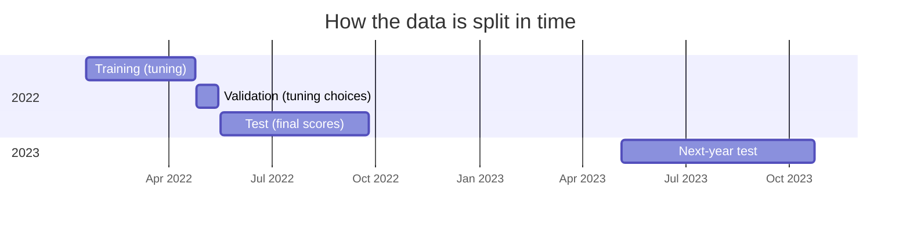

So the models learn only from 2022. 2023 only checks that they still work a year later, which they do: CO2 error 16% below the baseline, temperature 35% below, alert F1 0.90. Training on both years together would mix this check into the training data, so the 2023 result would no longer be an independent test.

---


## 5. What the Data Shows


On a normal Thursday in March, Room 01 (311 m³) went from outdoor level (~430 ppm) to **3,000 ppm within an hour** of a lecture starting. Opening the windows in the break dropped it sharply, and it climbed straight back. The two sensors (front and back) agree closely, so one sensor per room is enough.

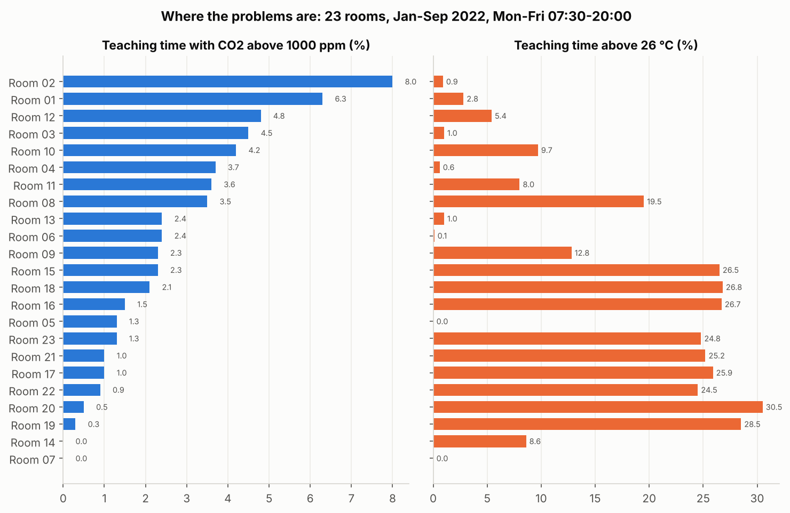

During teaching hours (Mon–Fri 07:30–20:00, including empty slots and lecture-free weeks):
- **CO2** is a ground-floor problem (Rooms 01–07): Room 02 is above 1000 ppm for 8% of teaching time and above 2000 ppm for 1.5%. Rooms 01 and 03 are similar.
- **Heat** is an upper-floor problem: rooms on floors 2–3 (Rooms 15–23) are **above 26 °C for 25–31% of teaching time**, the limit in the German workplace rule ASR A3.5.
- **Cold:** lecture hall Room 07 is below 20 °C for 29% of teaching time, and Room 23 for 17%.

---


## 6. Method

### 6.1 Pipeline

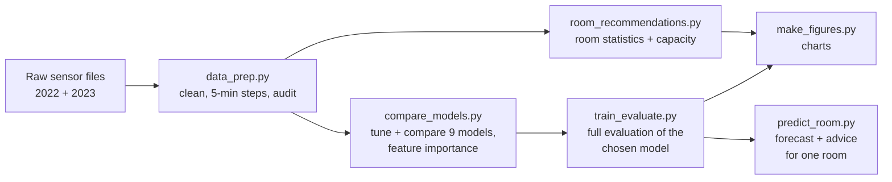

### 6.2 What the models see and predict
- Readings are averaged into 5-minute steps.
- **Each row is one sensor at one moment.** It includes:
  - the current readings;
  - recent history (5–60 minutes ago) and rates of change;
  - time of day and weekday;
  - room volume;
  - **the same time last week**, because lectures follow a weekly timetable.
- **Targets:**
  - CO2 and temperature 15, 30 and 60 minutes ahead (regression);
  - "will CO2 pass 1000 ppm in the next 30 minutes?" (classification).
- The models predict the **change** from the current value. This lets a model trained in spring still work in a hot summer, because tree models can't predict values outside their training range.
- Only teaching hours (Mon–Fri 07:30–20:00) are used for training and scoring.

### 6.3 The models

| Model | How it works | Strengths | Weaknesses (here) |
|---|---|---|---|
| **Persistence** (baseline) | Predicts that nothing changes: the value in 30 minutes equals the value now | Any useful forecast must beat it; slow-moving sensor values make it hard to beat | Can't foresee anything |
| **Linear regression** | Fits a weighted sum of the inputs (a straight line or plane) | Simple, explainable | Reproduced only to show why the 2023 method failed |
| **Ridge regression** | Linear regression with a penalty that keeps the weights small | Stable when many inputs are near-copies of each other (CO2 now, 5 min ago, 10 min ago…) | Can't capture on/off behaviour such as "CO2 jumps when a class starts" |
| **Logistic regression** | A linear model that outputs a probability (0–1) for a yes/no question | Simple, explainable alert baseline | Same linear limits |
| **Random Forest** | Grows many decision trees; each sees a random sample of rows and features, and their answers are averaged | Captures non-linear patterns, resists overfitting, little tuning needed | Slow on large data; can't predict beyond its training range |
| **HistGradientBoosting** | Builds small trees **one after another**, each fixing the errors the earlier trees still make (the idea behind XGBoost and LightGBM). "Hist" means each feature is first sorted into about 255 bins, which makes training very fast | High accuracy on tabular data, trains in seconds, handles missing readings natively | Same range limit as other trees (solved here by predicting the change) |
| **SVR** (support vector regression) | Fits a smooth curve that ignores errors smaller than a margin (epsilon), using a kernel to bend the curve | Good on small and medium data with smooth relationships | Training time grows roughly with the square of the rows, so only feasible on a sample here |
| **SARIMAX** | A classical statistical forecast for one series. **AR:** recent values. **I:** works on changes. **MA:** recent forecast errors. **S + X:** seasonality and extra inputs (here sine/cosine waves for the daily cycle and a weekend flag) | The standard time-series baseline; interpretable | One model per sensor, so it can't learn from other rooms; doesn't see motion |
| **LSTM** | A recurrent neural network that reads the last 60 minutes step by step and keeps a gated "memory" of what mattered | Learns patterns in sequences | Needs lots of tuning; varies between training runs; extrapolates badly to hotter months |
| **TCN** (temporal convolutional network) | Slides filters over the time sequence. "Causal" means it only looks backwards; "dilated" means each layer looks further back | Faster than an LSTM; sees a fixed window | Same instability as the LSTM |
| **Transformer** | Uses self-attention: every time step looks at every other one and learns which moments matter most | Flexible and powerful on large sequence data | Slowest to train here (about 14 minutes per setting) and no gain on this data |

### 6.4 The measures

| Measure | Meaning | Why used here |
|---|---|---|
| **MAE** | Average size of the error, in ppm or °C | The easiest to understand |
| **RMSE** | Like MAE, but big errors count more | Shows whether a model makes occasional large misses |
| **R²** | Share of the variation explained (1 = perfect) | Familiar, but not enough on its own: "no change" already scores 0.72 for CO2 |
| **Skill vs persistence** | How much smaller the error is than "no change" | The honest test of whether a forecast is useful |
| **Precision** | Of the alarms raised, how many were right | Too many false alarms and people ignore them |
| **Recall** | Of the real events, how many were caught | Missed events mean bad air |
| **F1** | The balance of precision and recall | One number for alert quality |
| **PR-AUC** | Alert quality across all possible thresholds | Only about 2% of moments are alarms, so accuracy would be meaningless (a model that never alarms is 98% "accurate"). PR-AUC is used instead of ROC-AUC because ROC-AUC flatters rare-event problems |
| **Permutation importance** | Shuffle one input and see how much worse the model gets | Shows what each model relies on |

### 6.5 How the models are tested

| Test | What it does | Question it answers |
|---|---|---|
| **Time split** | Train on earlier months, test on later months | Can it predict the future, not just neighbouring minutes? |
| **Leakage check** | The same model scored with a random split and with a time split | Were the old scores too good to be true? |
| **Unseen rooms** | The 23 rooms are split into 5 groups; the model is trained on 4 groups and tested on the 5th, repeated 5 times | Would it work in a room it has never seen? |
| **Next year** | Train on all of 2022, test on 2023 | Will it still work a year later? |
| **Three runs per deep model** | Each deep network is trained 3 times with different random starts | Are deep-model results stable? |

---


## 7. The Methods

### Why the original scores were spurious: leakage in time-series data
Sensor readings taken a minute apart are almost identical. A random 80/20 split scatters these near-duplicates across the training and test sets, so the model is effectively tested on data it has already seen. This is **data leakage**, and it makes the scores look far better than the model really is. The fix is to respect time: train on earlier months and test on later ones, as the model would be used in practice. I also measured how much leakage inflates the score. For the chosen CO2 model, a random split suggests a 20% improvement over the baseline, while the honest time split gives 8% (section 2).

### Why I predict the change, not the level
Tree-based models can only output values within the range they saw during training. My training months (January–May) were cooler than the test months (May–September). A tree model predicting the temperature *level* therefore systematically under-predicted the hot summer days. Predicting the *change* over the next 30 minutes avoids this, because changes stay in a similar range all year. The forecast is then the current value plus the predicted change. This one reformulation turned a model that lost to the baseline into one that beat it by about a third.

### How I judged the forecasts: the persistence baseline
CO2 and temperature change slowly, so the forecast "nothing will change in the next 30 minutes" is already quite good: it scores R² ≈ 0.72 for CO2. An R² near 0.8 can therefore sound impressive and mean very little. I compare every model with this **persistence baseline** and report its **skill**: the percentage by which it reduces the baseline's error. A model that cannot beat persistence adds complexity without adding value. I also report results separately for moments when people are in the room, because that is when forecasting matters and when the baseline is weakest.

### Why accuracy would be meaningless for the alert
Only about 2% of teaching-hour moments precede a crossing of 1000 ppm. A model that never raises an alarm would be 98% "accurate" and completely useless. This **class imbalance** is why I use precision, recall, F1 and PR-AUC. I also report a stricter subset, early warnings, where CO2 is still below 1000 ppm at the moment of prediction. A rule that just reacts to high CO2 scores well overall but cannot warn early at all, so this subset shows the model's real contribution.

### Why the tree models beat the deep networks here
I expected the sequence models (LSTM, TCN, Transformer) to do well, because the literature often favours them for sensor time series. On this data they did not. I think three reasons explain this, though I have not tested each one separately:
1. **The features already carry the history.** I built the useful history (recent trends, last week's pattern) into features that the tree models could use directly.
2. **Neural networks extrapolate poorly.** They handled the hotter test period worse than the trees: the LSTM's temperature forecast was worse than "no change".
3. **Deep models are unstable.** Their results varied by several ppm between training runs. I therefore trained each one three times and report the average.

This finding is specific to this dataset and feature set. It isn't a general claim that tree models are better.

### Why the true seasonal SARIMA had to be replaced
SARIMA models seasonality by linking each value to the value one season earlier. A daily season at 15-minute resolution means a lag of 96 steps. Fitting such a model did not finish for even one sensor within 15 minutes, and there are 33 sensors. I used the standard alternative for long seasonal cycles instead: ARIMA with **Fourier terms** (sine and cosine waves) for the daily cycle. I then checked my fast forecasting code against statsmodels' own forecasts, and they matched exactly.

### Reading feature importance correctly
**Permutation importance** shuffles one input at a time and measures how much worse the model gets. My forecasts add the current value to a predicted change. Shuffling "CO2 now" would therefore break that final addition and make the feature look misleadingly dominant. I measured importance on the change-prediction part of the model only, so the results reflect what the model actually learned.

### Estimating capacity without head counts
There is no record of how many people were in each room, so capacity cannot be learned from data. Instead, I used a standard **mass-balance** model: CO2 rises with the number of people and falls as fresh air replaces room air. I measured each room's background air exchange from how fast CO2 falls on quiet evenings. With an assumed CO2 output per person, the model estimates how long a group can stay before reaching 1000 ppm. These are planning estimates, not validated limits.

---

## 8. Results

### 7.1 Which model? A fair comparison on this data

Every model was trained and scored on **exactly the same rows** (`projectpipeline/compare_models.py`):
- **Training:** 18 Jan–24 Apr 2022.
- **Tuning:** every choice was judged on 25 Apr–15 May 2022, never on the test period.
- **Final scores:** 17 May–24 Sep 2022, scored once.

| Family | Model | Tuning (configurations tried on the validation weeks) |
|---|---|---|
| Baseline | Persistence (no change) | none needed |
| Linear | `Ridge` / `LogisticRegression` | 4 regularisation strengths |
| Tree ensemble | `RandomForestRegressor` / `Classifier` | 3 depth / leaf-size settings, 100 trees |
| Gradient boosting | `HistGradientBoostingRegressor` / `Classifier` | 10 random combinations of learning rate, tree size, leaf size, regularisation, number of trees |
| Kernel method | `SVR` (RBF kernel), **trained on a 10,000-row sample** | 3 values of C × 2 of epsilon |
| Classical time series | `SARIMAX` (statsmodels), one model per sensor | 3 ARIMA orders; daily cycle as Fourier terms (see note) |
| Deep learning | **LSTM**, **TCN** (temporal convolutional network) and **Transformer** (PyTorch) | 2 network sizes × 2 learning rates, up to 20 training rounds, early stopping; **each trained 3 times** with different random starts |

**How the models were trained:**
- **Tabular models** (linear, Random Forest, HistGradientBoosting, SVR): refit on all training weeks after tuning.
- **The three deep models:** given identical inputs (the last 60 minutes of readings, plus time of day, room size and last week's pattern) and identical outputs (CO2 change, temperature change, alert), so only the network type differs. They use the validation weeks for early stopping, so the network from their best training round is kept rather than refit. Their scores are the **average of 3 training runs**, because deep networks vary from run to run. For example, TCN's CO2 error ranged from 21.8 to 29.1 ppm across its three runs.
- **SVR:** training time grows roughly with the square of the number of rows, so it was trained on 10,000 rows instead of 385,000. Treat its scores as a feasibility check rather than SVR's best possible result.

- **Tuning budgets were not equal:** HistGradientBoosting tried 10 configurations, Random Forest 3, and the linear models 4. This slightly favours HistGradientBoosting. The gap to Random Forest is small (2–3% on CO2), so a larger search for Random Forest could narrow it, and this is listed as a limitation.


**Test-period results** (the alert threshold for each model was also chosen on the validation weeks):

| Model | CO2 30 min, people present (MAE ppm) | CO2 30 min, all teaching hours (MAE ppm) | Temperature 30 min (MAE °C) | Alert F1 | Alert F1, early warnings | Training time* |
|---|---|---|---|---|---|---|
| Persistence (no change) | 92.6 | 22.9 | 0.115 | 0.81 (rule) | 0.00 (rule) | – |
| Ridge / Logistic regression | 92.5 | 35.3 | 0.084 | 0.81 | 0.43 | 2–4 s |
| Random Forest | 79.2 | 21.9 | **0.074** | **0.87** | 0.58 | 25–180 s |
| **HistGradientBoosting** | **77.2** | **21.0** | 0.077 | **0.87** | **0.59** | **6–7 s** |
| SVR (10k-row sample) | 84.5 | 22.7 | 0.080 | – | – | 3 s (+ 2–4 min to predict) |
| SARIMAX (per sensor) | 88.6 | 30.0 | 0.078 | 0.85 | 0.33 | 177 s (all 33 sensors) |
| LSTM (avg of 3 runs) | 86.6 ± 0.4 | 25.1 ± 1.4 | 0.146 ± 0.034 | 0.83 | 0.48 | 90 s per setting |
| TCN (avg of 3 runs) | 81.6 ± 2.5 | 24.5 ± 3.2 | 0.079 ± 0.003 | 0.82 | 0.48 | 129 s per setting |
| Transformer (avg of 3 runs) | 80.8 ± 1.8 | 21.6 ± 1.0 | 0.087 ± 0.003 | 0.81 | 0.44 | 825 s per setting |

\*On a 2-core CPU. ± is the spread (standard deviation) over the three training runs.

**What the comparison shows, and why HistGradientBoosting was chosen:**
- **CO2:**
  - **HistGradientBoosting is best**, with Random Forest close behind.
  - Of the deep models, the Transformer comes closest (about 5% worse with people present), then TCN and LSTM.
  - SVR on its 10,000-row sample, SARIMAX and ridge regression barely beat "no change". One model per sensor can't learn from other rooms, and a linear model can't capture "CO2 rises fast only when a class starts".
- **Temperature:**
  - Random Forest is best, with HistGradientBoosting about 4% behind, then SARIMAX, TCN and SVR all close.
  - The LSTM did worse than "no change". The test months (summer) were hotter than the training months, and neural networks handle inputs outside their training range less gracefully than tree models. TCN and the Transformer coped better but still trail the tree models.
- **Alert:**
  - HistGradientBoosting and Random Forest are clearly best.
  - On early warnings, all three deep models scored below the simple "extend the last trend" rule.
- **Stability:** the deep models' CO2 results changed by more than 7 ppm between training runs (TCN). The tree models are deterministic for a given setting.
- **The overall choice:** **HistGradientBoosting is the only model that is best or within 5% of the best on all three tasks.** It also:
  - trains in seconds, against minutes for most of the others and about 14 minutes per setting for the Transformer;
  - handles missing readings without filling them in;
  - can be explained with feature importance.

  **On this data, none of the three deep models gave an accuracy gain over the tree models.** This is the usual finding when good features are built from tabular sensor data.

**Note on SARIMA.** A true seasonal SARIMA with a daily season (96 steps at 15-minute resolution) did not finish fitting even one sensor within 15 minutes, and the project has 33 sensors. The standard alternative for long seasonal cycles was used instead: ARIMA with Fourier terms for the daily cycle and a weekend indicator (SARIMAX with exogenous seasonality). Its forecasts were checked against statsmodels' own forecasting function and matched exactly.

**Models considered but not used.**
- **Gaussian Process Regression:** like SVR, it doesn't scale to hundreds of thousands of rows.
- **Hidden Markov Models:** estimate a hidden state such as "occupied or not", rather than forecasting values. There are no head counts to check such an estimate against.

### 7.2 Forecasting results with the chosen model (test period 17 May–24 Sep 2022)

Results from `train_evaluate.py`, using the tuned HistGradientBoostingRegressor:

| Target | Horizon | Persistence MAE | HistGradientBoostingRegressor MAE | Skill | R² |
|---|---|---|---|---|---|
| CO2, people present | 15 min | 56.8 ppm | **46.8 ppm** | **+18%** | 0.90 |
| CO2, people present | 30 min | 92.6 ppm | **77.3 ppm** | **+17%** | 0.78 |
| CO2, people present | 60 min | 135.8 ppm | **115.2 ppm** | **+15%** | 0.55 |
| CO2, all teaching hours | 30 min | 22.9 ppm | 21.0 ppm | +8% | 0.84 |
| Temperature, all teaching hours | 15 min | 0.062 °C | **0.043 °C** | **+31%** | 0.999 |
| Temperature, all teaching hours | 30 min | 0.115 °C | **0.077 °C** | **+33%** | 0.998 |
| Temperature, all teaching hours | 60 min | 0.215 °C | **0.152 °C** | **+29%** | 0.992 |

**How to read the temperature result.** The improvement is real, but small in absolute terms: about 0.04 °C. The sensor itself is only accurate to ±0.2 °C. In practice, temperature 30 minutes ahead is already very predictable. The useful output for temperature is the room-level picture in sections 5 and 9 (which rooms overheat or stay cold), not the forecast.

Rows marked *people present* had motion in the previous 30 minutes. These are the moments that matter, and where the model adds most over "no change".

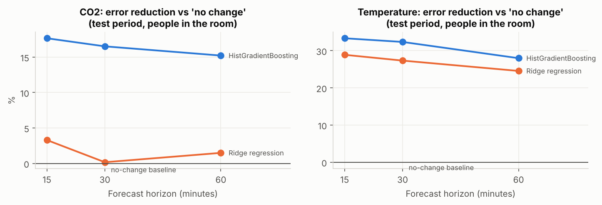
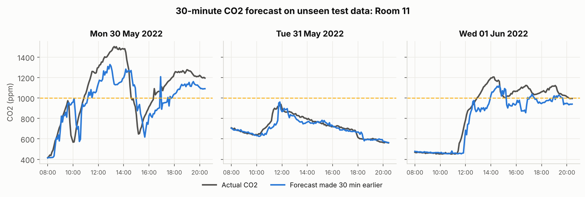

### 7.3 Ventilation alert: "will CO2 pass 1000 ppm in the next 30 minutes?"

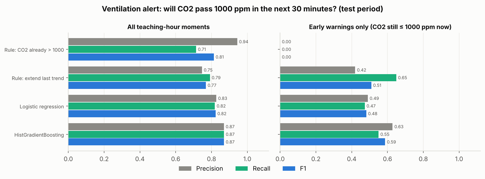

| Method | Precision | Recall | F1 | F1 on *early warnings* (CO2 still ≤ 1000 now) |
|---|---|---|---|---|
| Rule: CO2 is already > 1000 | 0.94 | 0.71 | 0.81 | 0.00 (it can never warn early) |
| Rule: extend the last 5-min trend | 0.75 | 0.79 | 0.77 | 0.51 |
| Logistic regression (default settings; tuned version in 7.1) | 0.83 | 0.82 | 0.82 | 0.48 |
| **HistGradientBoostingClassifier** | **0.87** | **0.87** | **0.87** | **0.59** (PR-AUC 0.63) |

**How to read F1 0.87.** Part of it comes from easy cases where CO2 is already high: the simple rule scores 0.81 on those. The meaningful number is the early-warning case, warning *before* the limit is passed. There the model catches 55% of upcoming crossings, and 63% of its warnings are correct.

### 7.4 Does it generalise?

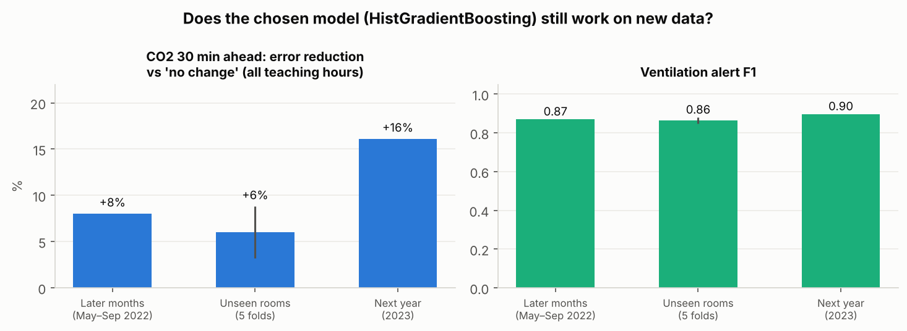

| Test | CO2 30-min MAE (HistGradientBoostingRegressor) | Alert F1 (HistGradientBoostingClassifier) |
|---|---|---|
| Trained on Jan–May 2022, tested on May–Sep 2022 (above) | 21.0 ppm (+8% vs persistence) | 0.87 |
| **Unseen rooms** (5 folds, 4–5 rooms held out each time) | 21.4 ± 1.7 ppm (+6% ± 3%) | 0.86 ± 0.02 |
| **Next year: train on 2022, test on 2023** | 50.9 ppm vs 60.6 for persistence (+16%, R² 0.79) | **0.90** (rule: 0.85) |

2023 temperature, 30 min ahead: MAE 0.097 °C vs 0.149 °C for persistence (+35%). The 2023 data arrives through a different platform with gaps, and its motion and light counts are on a different scale, so this test leaves out motion and light. Errors are larger in 2023 because rooms there spent more time at high CO2.

### 7.5 What drives the predictions (feature importance)

Permutation importance on 40,000 test rows (`results/feature_importance.csv`). Each feature is shuffled in turn, and the importance is how much worse the model gets. For the forecasts, importance is measured on the part of the model that predicts the *change*, so the current value isn't counted twice.

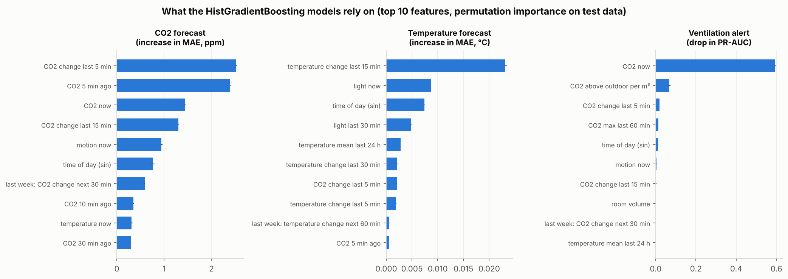

- **CO2 forecast:**
  - Driven mainly by how fast CO2 is rising right now (change over the last 5 and 15 minutes) and by motion.
  - Next come time of day and **what happened in the same room at the same time last week**. Last week stands in for the lecture timetable, which the sensors don't know.
- **Temperature forecast:**
  - Driven by its own recent trend, then by **light** (sunshine through the windows) and time of day.
  - This matches the heat finding: upper-floor rooms warm up in the sun.
- **Alert:** dominated by the current CO2 level, then by CO2 relative to room size. Small rooms fill up faster.

---


## 9. Room Recommendations

`results/room_recommendations.csv` has one row per room. It uses a standard well-mixed CO2 balance

  dC/dt = n·G/V − ACH·(C − C_outdoor)

with C_outdoor = 420 ppm and G = 0.020 m³ CO2 per seated adult per hour. ACH (air changes per hour with the room empty and windows shut) is **measured for each room** from how fast CO2 falls on quiet evenings (median 0.15 per hour; 0.5 assumed for the 6 rooms with too few clean evenings, which are marked in the CSV).

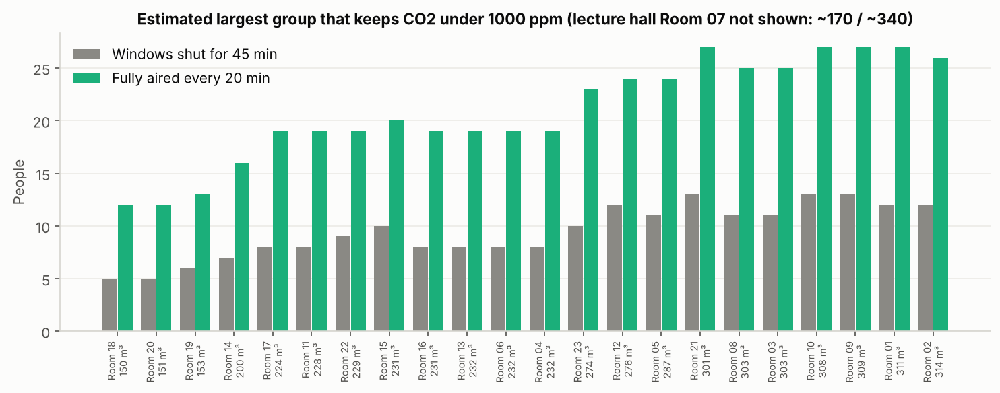

Main findings:
- With windows shut, a typical 230–310 m³ seminar room stays under 1000 ppm for a 45-minute session with only **8–13 people**. With 30 people it passes 1000 ppm in **13–18 minutes**.
- **Fully airing every 20 minutes** (the Umweltbundesamt recommendation) roughly doubles that to **19–27 people**.
- Keeping 30 people under 1000 ppm continuously needs about **3.3–4.6 air changes per hour** in those rooms (~7 in the 150 m³ rooms). Window airing in breaks can't deliver that, so full classes need mechanical ventilation, or extra airing during the class.
- The measured rates of CO2 rise point to groups of roughly 20–25 people in the busiest ground-floor rooms. That's a lower bound, because doors and windows open during class.

**Recommended actions**
1. **Rooms 01, 02 and 03:** air fully every 20 minutes during class and in every break, or cap groups at about 25. These are the only rooms that regularly pass 2000 ppm.
2. **Upper floors (Rooms 15–23):** overheating is the main issue. Use shading, fans or cooling, and air in the early morning. Small rooms 18, 19 and 20 (~150 m³) should take at most about 12 people with regular airing.
3. **Rooms 07 and 23:** check the heating; they are often below 20 °C.
4. Put the 30-minute alert on the existing sensors: *"air this room within 15–20 minutes"*, as an alternative to a fixed timer.

---


## 10. Limitations and Future Work

**Limitations**


- **No head counts or timetable.** Occupancy is only inferred from motion and CO2 rise. Linking the room booking timetable would most improve the 60-minute CO2 forecast. Without it, the 60-minute forecast across *all* teaching hours is only level with persistence (MAE 35.2 vs 35.4 ppm), because the model sometimes expects a class that doesn't happen.
- **One test period, no significance tests.** Models were compared on a single four-month test period. The top three CO2 models are within 3% of each other, so their order could change with a different period. The unseen-rooms and next-year tests support the overall conclusions, but no formal statistical test was run.
- **Small and unequal tuning budgets.** Each model family got 3–10 configurations (HistGradientBoosting 10, Random Forest 3), and SVR was trained on a 10,000-row sample. A larger search could change the details, though probably not the overall ranking.
- The capacity numbers come from a physical model with assumed CO2 output per person and fully mixed air. They are planning estimates, not measured limits.
- The 2022 data covers January–September, so the winter semester is only partly represented.
- **2023 coverage is patchy.** Each sensor has only a few week-long stretches of data between May and October 2023 (figure 11), and Room 02's back sensor has no 2023 data. 2022 has no data at all for any sensor from 2 to 10 April.

---


**Future work**
- **Timetable or booking data.** Linking the room booking system would tell the model when classes start and end. This is likely the largest single improvement for the 60-minute CO2 forecast.
- **Head counts.** Even a few weeks of counted occupancy would make it possible to validate, or correct, the capacity estimates.
- **Significance testing.** Resampling test days (block bootstrap) would show whether the small differences between the top models are reliable.
- **Equal tuning budgets** for Random Forest and HistGradientBoosting, and separate deep networks per task instead of one shared network.
- **Live deployment.** Run the alert on the existing sensors and check, with lecturers, whether earlier airing actually lowers peak CO2.

---

## 11. Design Decisions and Robustness

### Choosing the final model
HistGradientBoosting and Random Forest finished close together, so the final choice also weighed consistency and practicality. HistGradientBoosting was the most accurate model for CO2 and the ventilation alert. It came within about 4% of Random Forest on temperature, and it trained roughly 30 times faster. Its tuning search was somewhat larger (10 configurations, against 3 for Random Forest), which may have helped it slightly. Given the margins involved, the choice rests as much on speed and consistency across all three tasks as on raw accuracy (section 8.1).

### Where deep learning fits
The three sequence models (LSTM, TCN and Transformer) were included because they are widely used for sensor time series. Here they did not improve on the tree models, for three likely reasons:
- the most useful history, such as recent trends and the same hour last week, was already engineered into features the tree models could use directly;
- the summer test period was warmer than the training months, and neural networks generalise less gracefully to values outside their training range;
- the deep models varied by several ppm from one training run to the next, so each was trained three times and averaged.

These reasons are plausible but have not each been tested separately. With richer inputs, such as timetables or longer raw sequences, the balance could shift.

### Guarding against leakage
Every feature is computed from information available at the moment of the forecast; the "same time last week" pattern, for example, always lies in the past. Training, validation and test periods are separated in time, with a one-day gap between them. The cost of ignoring this is measured directly in section 2: a random split would have inflated the apparent benefit of the CO2 forecast about two and a half times.

### Interpreting the temperature forecast
The temperature forecast is statistically better than assuming no change, but the absolute gain, about 0.04 °C, is smaller than the sensor's own accuracy of ±0.2 °C. The more valuable temperature result is therefore the room-level picture: which rooms regularly overheat or stay cold (sections 5 and 9).

### Status of the capacity estimates
The capacity figures come from a standard physical model, not from learned data. Background air exchange was measured for 17 rooms and assumed for the remaining 6. The CO2 output per person is a literature-based assumption. No head counts were available to validate the estimates, so they are best read as planning guidance (section 10).

### Stability of the results
- **Unseen rooms:** results are averaged over five held-out groups of rooms, and their spread is reported.
- **Deep models:** results are averaged over three independent training runs, again with the spread reported.
- **Next year:** the 2023 data provides a fully independent check a year later.

No formal significance test was run, so small differences between the top models should not be over-interpreted.

### Reproducibility
`run.py` and the pinned `requirements.txt` rebuild every number and chart in this README from the raw data. Because the data is not public (section 2), the repository shares the full code, results and figures instead.

### The most valuable next step
Linking the room booking timetable, or collecting even a few weeks of head counts, would add the information the sensors cannot provide: when classes start and how many people attend. This would most likely sharpen the CO2 forecast (especially 60 minutes ahead) and allow the capacity estimates to be validated.

---


## 12. Guide Values Used
- CO2 (Umweltbundesamt): below 1000 ppm is hygienically fine, 1000–2000 ppm is concerning, above 2000 ppm is unacceptable. During lessons, air with windows wide open every 20 minutes.
- Temperature (ASR A3.5): at least 20 °C for seated light work, and should not exceed 26 °C.


---


## 13. How to Run

**Python version.** Use Python 3.12 or 3.13. PyTorch, which the LSTM, TCN and Transformer need, does not support Python 3.15 yet. Everything else also runs on 3.15: without PyTorch, the three deep models are skipped with a message. `requirements.txt` pins the exact library versions used for the results in this README; other versions can shift the last decimals.

**Data.** Place the data in `Data/` as described in section 4.1.

```bash
pip install -r requirements.txt
python run.py              # runs steps 1-5 below in order (about 5–6 hours on a laptop CPU, mostly step 2)
```

Or run the steps one at a time (each step needs the one before it to have run at least once):

```bash
cd projectpipeline
python data_prep.py              # 1. read Data/DF22 and Data/Sensor Data 2023, clean, 5-min steps
                                 #    -> outputs/clean_2022.pkl, clean_2023.pkl, results/data_audit.csv  (~1 min)
python compare_models.py         # 2. tune and compare all nine models, feature importance
                                 #    -> results/model_comparison.json, tuned_params.json, feature_importance.csv
                                 #    (~5 hours; the Transformer alone takes ~3 hours on a 2-core CPU)
                                 #    parts can be re-run alone, e.g.  python compare_models.py lstm
                                 #    (parts: tabular, importance, sarimax, svr, lstm, tcn, transformer, deep)
python train_evaluate.py         # 3. full evaluation of the chosen (tuned) HistGradientBoosting models
                                 #    -> results/metrics.json, outputs/model_*.joblib  (~12 min)
python room_recommendations.py   # 4. per-room statistics, air-change rates, capacity -> results/room_recommendations.csv  (~1 min)
python make_figures.py           # 5. charts -> results/figures/  (~2 min)
python predict_room.py --room "Room 01" --time "2022-03-17 08:15"   # optional: forecast + advice for one room and time
```

`features.py` is not run on its own. The other scripts import their shared settings and feature code from it.

Example output of `predict_room.py`:
```
Room 01 at Thu 17 Mar 2022 08:15
  CO2 now 1148 ppm -> forecast in 30 min 1970 ppm
  Temperature now 20.8 C -> forecast in 30 min 21.8 C
  Chance CO2 passes 1000 ppm in the next 30 min: 99%
  Advice:
   - Plan to air the room within the next 15-20 minutes
   - Capacity guide: about 12 people with windows shut for 45 min, 27 if fully aired every 20 min
```
(The CO2 in this room actually reached about 2,500 ppm 30 minutes later: the forecast was in the right direction but too low, as section 8.2 would lead you to expect at the start of a class.)

### What is in `results/`

| File | Contents |
|---|---|
| `model_comparison.json` | The comparison of all nine models in section 8.1: best settings found, validation score, test scores and training time for every model. |
| `tuned_params.json` | The settings chosen on the validation weeks. `train_evaluate.py` reads these, so the main evaluation uses the tuned models. |
| `feature_importance.csv` | Permutation importance of every feature for the three HistGradientBoosting models (section 8.5). |
| `metrics.json` | Every score in sections 2 and 8.2–8.4, in six parts: `linear_regression` (the original 2023 method), `ridge_regression_and_hist_gradient_boosting_regressor` (forecasts 15/30/60 min ahead, with the persistence baseline), `logistic_regression_and_hist_gradient_boosting_classifier` (the ventilation alert, with the two rules), `leakage_check_co2_30` (random split vs time split), `unseen_rooms_5fold` and `next_year_2023`. |
| `room_recommendations.csv` | One row per room: CO2 and temperature statistics during teaching hours, measured air leakage, estimated capacity, and the advice (section 9). |
| `data_audit.csv` | Readings in, readings removed and 5-minute values out, per year and measurement (section 4). |
| `figures/` | The eleven charts shown in this README. |

### Folder map
```
Data/                         input data (not included; see section 4.1)
projectpipeline/
  data_prep.py                1. clean + 5-minute resampling (2022 and 2023)
  features.py                 shared features, targets, guide values (imported, not run)
  compare_models.py           2. tuning + comparison of nine models + feature importance
  train_evaluate.py           3. full evaluation of the chosen models
  room_recommendations.py     4. per-room statistics + capacity model
  make_figures.py             5. figures
  predict_room.py             optional: use the trained models for one room and time
run.py                        runs steps 1-5
requirements.txt              Python libraries (pinned versions)
results/                      final results shown in this README (see table above)
outputs/                      working files the code rebuilds each run (not in the repository)
LICENSE                       copyright notice
```

---


## 14. License

© 2026 Syeda Nimra Fatima. **All rights reserved.**

This code is shared for viewing and evaluation only. It may not be copied, modified, distributed or used, in whole or in part, without my prior written permission. To request permission, email inimrasyed@gmail.com. Full terms are in [LICENSE](LICENSE).

The sensor data belongs to the university that collected it. It isn't included in this repository and isn't covered by this license.

## 15. Contact

Syeda Nimra Fatima
inimrasyed@gmail.com
GitHub: [SyedaNimraFatima](https://github.com/SyedaNimraFatima)
